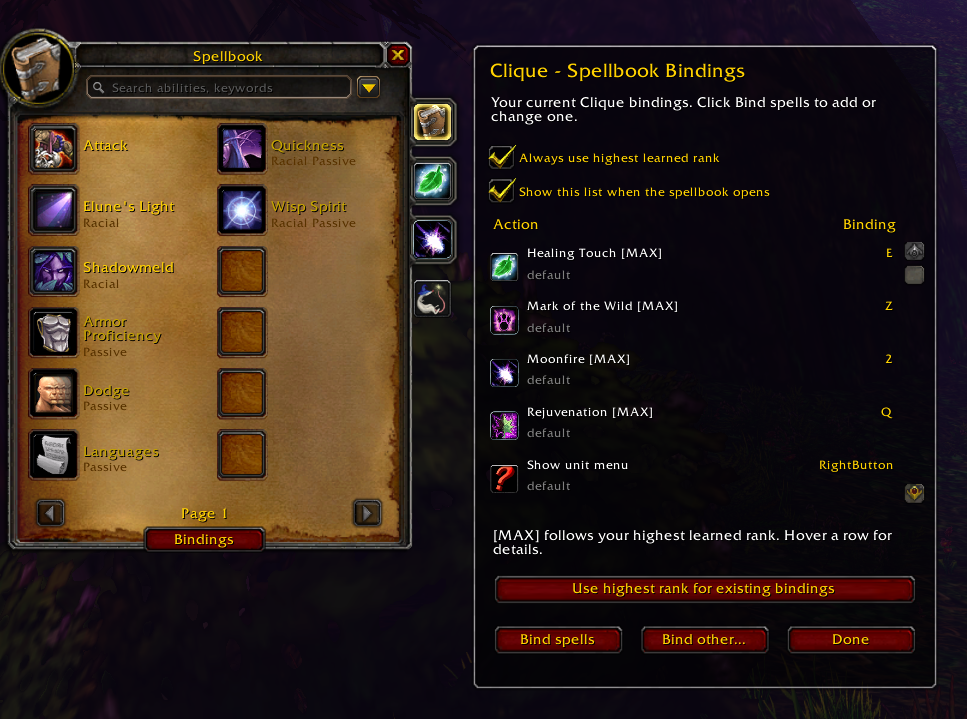

# Clique Spellbook Companion

Direct spellbook binding and a live Clique binding list for **WoW Forever with EllesmereUI's Classic Spellbook**.

By **Afoekon** · MIT licensed · **Beta**

## Requirements

- WoW Forever (interface 16001).
- [Clique](https://www.curseforge.com/wow/addons/clique), enabled. Developed against v5.1.5-release.
- [EllesmereUI](https://www.curseforge.com/wow/addons/ellesmereui), including its Forever Essentials module, enabled with **Classic Spellbook** switched on.

This currently supports EllesmereUI's replacement spellbook only. It does not add binding support to Blizzard's normal spellbook, and is not tested on Retail, Classic Era, or other clients.

## Features

- Bind spells directly from the classic spellbook with mouse buttons, modifier combinations, keyboard keys, or the mouse wheel.
- New bindings use your highest learned spell rank by default. You can choose an explicit lower rank instead.
- See a live, scrollable list of actions, bindings, and binding sets beside your spellbook.
- Show or hide the list independently of binding mode, and choose whether it opens with the spellbook.
- Open Clique's full editor for custom macros and specialized bindings.
- Convert the active profile's existing spell bindings to rank-free names, with a saved snapshot before the first conversion. Custom macro text is unchanged.

## Installation

Install Clique and EllesmereUI separately; Forever Essentials is included with EllesmereUI. Extract the release ZIP so the folder is `Interface/AddOns/CliqueSpellbookCompanion/` and contains `CliqueSpellbookCompanion.toc`. Restart WoW for a new install; `/reload` is sufficient when updating existing files. Enable Clique, EllesmereUI, and its Forever Essentials module and EllesmereUI's Classic Spellbook feature.

Use the packaged release ZIP for installation. A GitHub source-code download adds an outer directory that you must remove.

## Usage

1. Open your spellbook with **P**. The binding list opens beside it by default.
2. Click **Bind spells** or the hand/book tab to enter binding mode.
3. Hover a spell icon and press or click the desired combination.
4. Click **Stop binding** to keep viewing, or **Done** to close the panel.

**Bindings** shows or hides the list without capturing spell input. **Bind other...** opens Clique's editor; this closes the spellbook. Hover list rows for full binding details and custom macro text.

`/csc` opens the book in binding mode. `/csc status` prints the companion, Clique, and EllesmereUI versions and attachment status.

## Binding behavior

New bindings use Clique's default unit-frame set. Reusing a key replaces its existing default-only binding, including a target/menu action; specialized friend/enemy/combat/spec bindings are preserved. Use Clique's editor to customize those sets.

`[MAX]` means no fixed rank is stored. Clearing **Always use highest learned rank** binds the selected rank. Settings apply across characters; the displayed bindings follow the active Clique profile. Conversion of existing bindings is performed separately per profile. Rank-text conversion currently recognizes English `Rank N` labels.

Binding configuration is unavailable in combat. This addon does not modify Clique or EllesmereUI files, change display resolution, resize action bars, or automate spell casting.

## Beta status and support

The original bridge was tested in game for keyboard binding and casting Rejuvenation on a unit frame, and the user confirmed v1.0.0 working. The live-list update passed isolated Lua behavior checks, and the screenshot above shows its layout in game. Combat transitions and training new spell ranks still need broader in-game testing. Start with a backed-up Clique profile.

Report the steps to reproduce a problem, `/csc status` output, client version/language, and the exact error message. Avoid including account details or full saved-variable files in public reports.

Updates to Clique, EllesmereUI, or WoW may require a companion update. Disable this companion in the AddOns list to remove its interface; existing bindings remain in Clique.

## Credits and license

Independent companion by Afoekon, developed with AI assistance. Not affiliated with or endorsed by Clique, EllesmereUI, or Blizzard. Those projects and their assets belong to their respective authors. This distribution contains the companion's own code and icon; it does not bundle Clique or EllesmereUI.

Released under the MIT License. Retain the copyright and license notice when redistributing copies or substantial portions. See [LICENSE](LICENSE).
